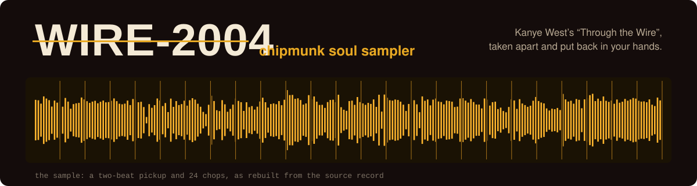
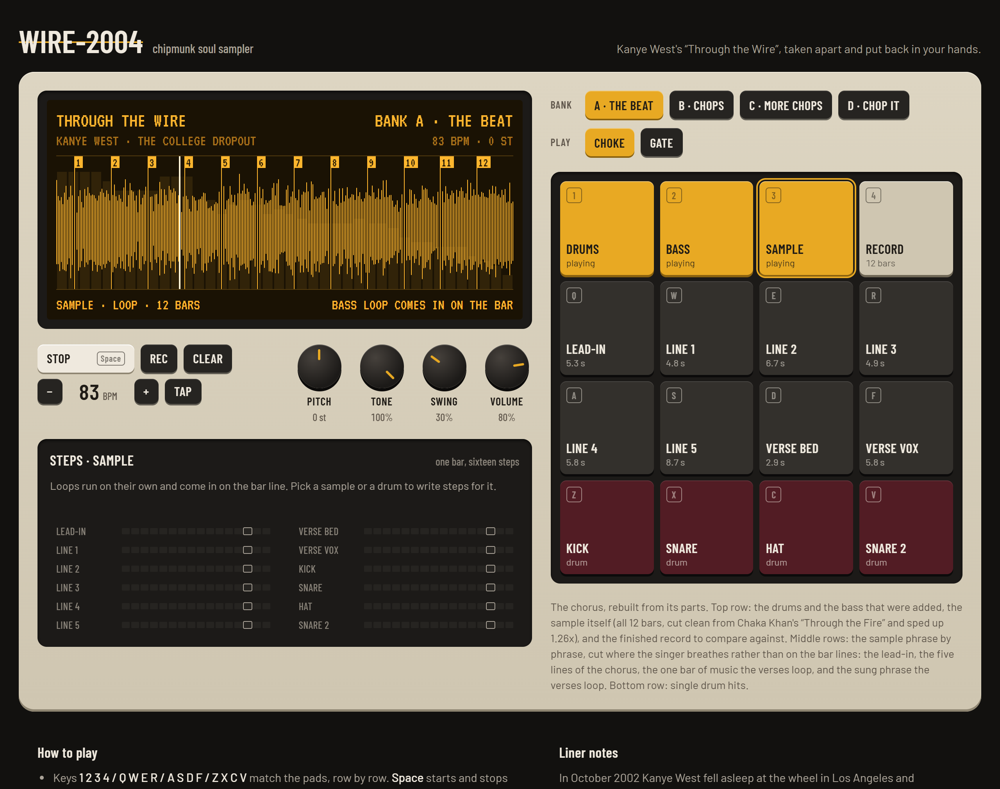
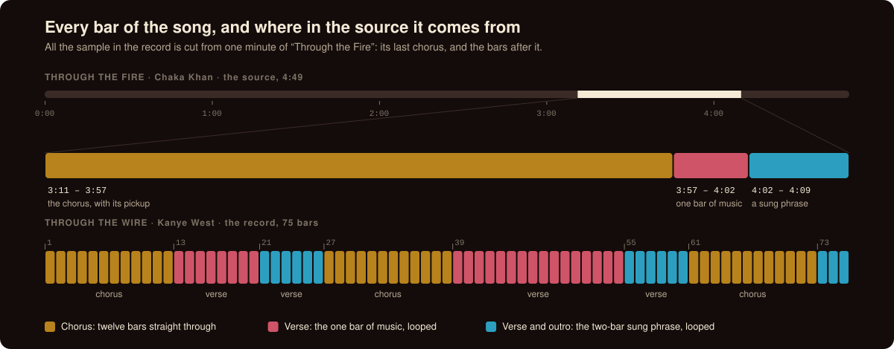
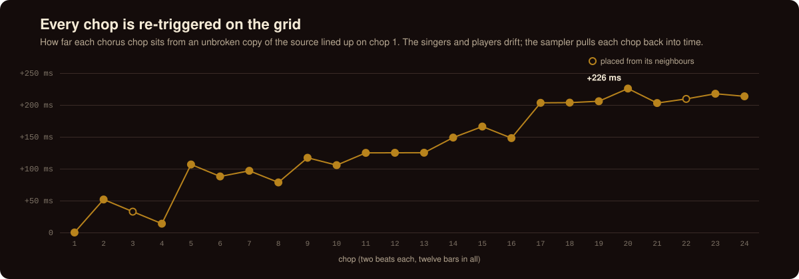
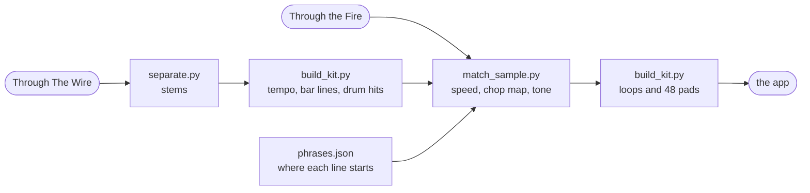

<p align="center">
  
</p>

<p align="center">
  
  
  
  
  
</p>

**WIRE-2004 reverse-engineers one beat and puts it on pads.** It lines Kanye West's "Through the Wire" up against the record it samples, Chaka Khan's "Through the Fire", works out exactly how the beat was built, and rebuilds it in the browser from the source record: every chop, at the speed, level and tone it has on the finished song.

Most sampler demos slice a song into equal pieces. This one finds the pieces that were actually used.

<p align="center">
  
</p>

## What it found

The source recording is inside the finished mix, so the two waveforms correlate. That places every piece of sample to within a millisecond, with no guessing by ear.

<p align="center">
  
</p>

Every bit of sample in the song comes from **one minute** of the source, 3:11 to 4:10:

| In the song | Bars | From "Through the Fire" |
| --- | --- | --- |
| Chorus, three times | 1–12, 27–38, 61–72 | 3:13 to 3:57, twelve bars straight through, entered on a two-beat pickup from 3:11 |
| Verse | 13–20, 39–54 | One bar of music from 3:58, looped one beat late, with a turnaround every four bars |
| Verse and outro | 21–26, 55–60, 73–75 | A two-bar sung phrase from 4:02, looped |

And this is how it was treated on the way in:

| | Measured |
| --- | --- |
| **Speed** | 1.2595 times faster, +3.99 semitones: four semitones up on the sampler |
| **Chops** | Two beats each, played in order, each one re-triggered on the grid |
| **Channel** | Mono, from the **left channel only**. The right channel of the source is not on the record |
| **Tone** | Flat up to 4 kHz, about 5 dB down at 4–8 kHz, gone above 8 kHz, the way a sampler's filter does it |
| **Level** | About a quarter of the source's level, polarity flipped |
| **On top** | New drums and bass at a steady 82.99 BPM |

<p align="center">
  
</p>

The source was played by people and its tempo wanders. A straight copy would slide a quarter of a second out of time over twelve bars. Cutting it into chops and re-triggering each one on the grid is what holds it in the pocket, and it is why the chops, not one long sample, are the real building blocks.

## What you can do with it

| Bank | What is on the pads |
| --- | --- |
| **A · The Beat** | The chorus rebuilt. Four twelve-bar loops that stack in time: the added **drums**, the added **bass**, the **sample** cut clean from the source, and the finished **record** to check your rebuild against. Under them, the sample phrase by phrase: the lead-in, the five lines of the chorus, the bar of music the verses loop, and the sung phrase the verses loop. Then four drum hits |
| **B and C · The Chops** | The sample the way it sat on the pads: the pickup, the chorus's 24 chops, and the 7 the verses are built from. In order they make the record. Out of order they make something new |
| **D · Chop It** | Twelve chops you place yourself anywhere in the song, on the beat or on the transients, from the full mix or any of five stems |

- **Loops come in on the bar.** Tap one and it waits for the bar line, then joins at the bar the others have reached. The sample and the record come in on their pickup, half a bar early, as they do on the song.
- **Phrases are cut where the singer breathes**, not on bar lines. A sung line starts before the bar and rings on past it; cut on the bar and every pad holds the tail of one line and the head of the next.
- **Pitch** re-pitches the chops by ±12 semitones, varispeed, the way chipmunk soul was made. Change the tempo and the loops speed up with it, like tape.
- **Sequencer**: sixteen steps and a pattern for every pad, live recording, swing, tap tempo.
- **Choke and gate**: chops cut each other off, and can stop when you let go.
- The screen shows the selected sound, its playhead, and for a chop, where in the source it comes from.
- Every pad says what it will do: how long a phrase runs, where in the source a chop comes from, whether a loop is playing or waiting for the bar.

```
             Bank A                        Bank B              Bank C         Bank D
1 2 3 4      drums, bass, sample, record   pickup, chops 1-3   chops 16-19    your chops 1-4
Q W E R      lead-in, lines 1-3            chops 4-7           chops 20-23    your chops 5-8
A S D F      lines 4-5, verse bed, vox     chops 8-11          chops 24-27    your chops 9-12
Z X C V      kick, snare, hat, snare 2     chops 12-15         chops 28-31    kick, snare, hat, snare 2
SPACE        play / stop
ESC          silence everything
← →          previous / next bank
```

## How it was worked out



1. **Split the song into stems** with Demucs, and read the tempo and bar lines off the drum stem.
2. **Find the speed.** On a log-frequency axis a change of playback speed is a plain shift, so every speed from 1.0x to 1.9x can be tried cheaply against the source's pitch content.
3. **Find the chops.** With the speed known, slide short windows of the finished record along the sped-up source. Where the lag stays constant, that is one chop; where it jumps, the next one starts. The jumps fall every two beats.
4. **Find how far the sample runs.** Follow the source outwards from the clean part of the chorus for as long as it turns up the same way every time the chorus comes round. That gives twelve bars and a pickup, where the part nobody raps over is only eight.
5. **Find how it was sampled.** Ask which blend of the source's left and right channels is on the record (left only), and compare the two an octave at a time for level and tone.
6. **Map the rest.** Look for the bars that follow the chorus anywhere in the song. They turn up under the verses.
7. **Cut the pads.** The chops come straight out of the source record, sped up, low-passed and levelled to match. The phrase pads are cut at the gaps where the singer breathes.

## Run it

```bash
npm install
```

```bash
npm run dev
```

Then open http://localhost:5173.

A fresh clone has no audio in it. Without a kit the app falls back to Apple's official 30-second preview of the song and a synthesized drum kit, so there is something to play straight away.

## Build the kit

The kit is built on your own machine from copies of the two songs that you own. Everything lands in `public/kit/`, which is git-ignored, and the app picks it up on its own.

```bash
python -m venv --system-site-packages .venv
```

```bash
.venv/Scripts/python -m pip install demucs soundfile
```

```bash
.venv/Scripts/python tools/separate.py "Through The Wire.mp3"
```

```bash
.venv/Scripts/python tools/build_kit.py
```

```bash
.venv/Scripts/python tools/match_sample.py "Through the Fire.mp3"
```

```bash
.venv/Scripts/python tools/build_kit.py
```

| Step | What it does |
| --- | --- |
| `separate.py` | Splits the song into stems with Demucs. A few minutes on a CPU |
| `build_kit.py` | Finds the tempo, the bar lines and the cleanest eight bars of the chorus, and picks the best kick, snare and hi-hat hits out of the drum stem |
| `match_sample.py` | Traces the sample to the source: speed, chop map, how far the chorus runs, how it was sampled. Cuts the chops and the phrase pads out of the source. About a minute |
| `build_kit.py` again | Cuts the drum, bass and record loops to the chorus's full length and lays out the pads |
| `find_phrases.py` | Optional. Lists the sung phrases in a stretch of the source and the breaths between them, for filling in `tools/phrases.json` |
| `docs/make_figures.py` | Optional. Redraws the figures on this page from the measurements |

Stop after the second step and you still get a playable kit, with the sample pads taken from the stems of the finished song instead of the source.

## What is measured, and what is not

- **Measured.** The speed, the chop positions, the channel, the level and the song's structure all come from waveform correlation. Of the chorus's 24 chops, 22 are found in the record outright, each well clear of chance.
- **Placed from neighbours.** Two chorus chops sit under louder parts of the mix and take their position from the chops either side of them.
- **Estimated.** The treble roll-off is measured where drums and vocals cover much of the sample, so the 5 kHz corner is a best fit.
- **Separated, not original.** The drum and bass loops come from Demucs stems of the finished song, because those parts are not on the source record. Some bleed is audible.
- **Not rebuilt.** The verse loops are mapped, and their raw material is on the pads, but they are not offered as ready-made loops.

## Inside

```
src/audio/engine.js      playback, kit loading, synced loops, sequencer, state
src/audio/slicer.js      transient detection and waveform peaks
src/audio/drums.js       fallback drum synth for when there is no kit
src/components/          screen, pads, knobs, step sequencer
tools/separate.py        song -> stems
tools/build_kit.py       stems -> tempo, bar lines, loops, drum hits, kit.json
tools/match_sample.py    source record -> speed, chop map, the chops themselves
tools/find_phrases.py    source record -> where each sung phrase starts and ends
tools/phrases.json       the phrase cuts used for the pads
docs/make_figures.py     measurements -> the figures on this page
```

React and Vite, with no other runtime dependencies. All sound goes through the Web Audio API: a lookahead scheduler drives the sequencer and starts loops on the bar line, sample-accurately.

## Credits

"Through the Wire" by Kanye West, from The College Dropout (2004). "Through the Fire" by Chaka Khan, from I Feel for You (1984), written by David Foster, Tom Keane and Cynthia Weil. Both recordings belong to their rights holders. This is a fan project made to study how a beat was put together, and it ships neither recording.
