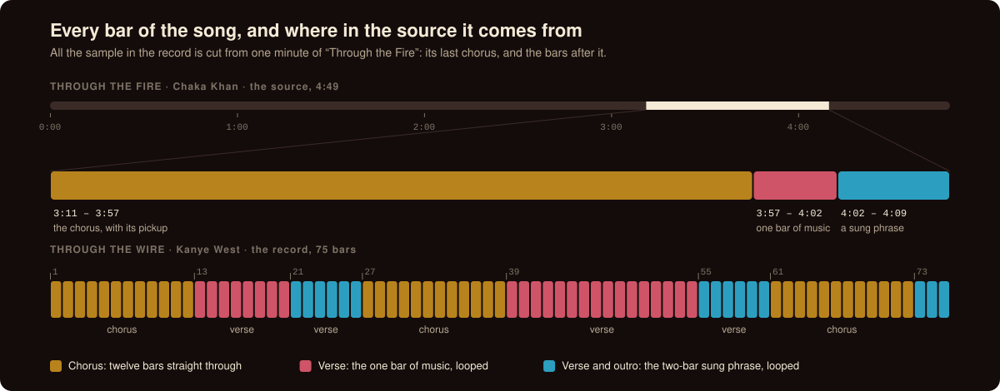
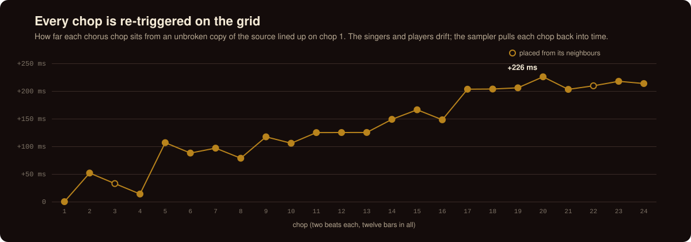

# How the beat was worked out

This is the long version of the method in the [README](../README.md). Everything here is a measurement made by the scripts in `tools/` on two recordings: "Through the Wire" and the record it samples, "Through the Fire". Nothing was placed by ear.

  

## The idea

A sampled record contains the source recording itself, not a new performance of it. Slow the song down by the right amount, or speed the source up, and somewhere inside the mix the two waveforms are the same signal. Signals that are the same correlate, sharply, and only when they are lined up to within a fraction of a millisecond. So the job comes down to two questions: what is the right amount, and where does it line up.

## 1. Tempo and bar lines

`build_kit.py` takes the drum stem from Demucs and turns it into an onset envelope: how much louder each moment is than the one before, summed across frequency. A comb of evenly spaced beats is slid over that envelope at every tempo from 70 to 140 BPM and every phase. The best fit, refined in a second, finer pass, is **82.99 BPM**, with the first bar line at 1.59 s.

A small tempo error matters: a hundredth of a BPM is a tenth of a second by the end of the song. That is why the fine pass steps in thousandths.

## 2. The speed, coarsely

On a log-frequency axis, playing a record faster does two simple things: everything moves up by a fixed number of bins, and everything goes by sooner. `match_sample.py` builds a pitch map of the source (36 bins an octave), and for each speed from 1.0x to 1.9x shifts and squeezes that map and slides the eight cleanest bars of the chorus along it.

Each bar is allowed to land anywhere, so a re-chopped sample would still be found. Here the bars land one after another. Best speed: about 1.26x.

## 3. The speed, exactly, and the chops

With the speed roughly known, the source is resampled to play that much faster and compared with the finished record directly, waveform against waveform, in the band where the sample is strongest against the drums and bass over it (150 to 1500 Hz).

Short windows of the record are slid along the sped-up source. Two things come out of how the best lag behaves from one window to the next:

- **If the speed is slightly off, the lag creeps.** Measuring the creep inside runs of windows that agree gives a correction, applied until it vanishes: **1.2595x, +3.99 semitones**. Four semitones up, as near as can be measured.
- **Where the lag jumps, a new chop starts.** Inside a chop the lag is constant to a tenth of a millisecond. Every two beats it steps to a new value. That is the signature of a sampler re-triggering chops on a grid.

  

The source was played by people, and against a steady grid it drifts by about a quarter of a second over twelve bars. An unbroken copy would have slid out of time. Chopping it and re-triggering each piece is what keeps it in the pocket.

## 4. How far the chorus runs

The cleanest eight bars are not the whole chorus. To find the rest, the matcher walks outwards from them a chop at a time, in both directions, and keeps going for as long as the source carries on **the same way every time the chorus comes round** in the song. One unclear chop is let through if the one beyond it is clear again, since somebody rapping over a chop does not mean it is not there.

That gives **12 bars and a two-beat pickup**, coming round at bars 1, 27, 61. The rule matters: the source does carry on a little further under the start of two of the verses, but not the third time, so those bars belong to the verses and not the chorus.

## 5. How it was sampled

Three things are measured by comparing the cut chops with the record:

- **Channel.** Which blend of the source's left and right channels best explains the record? The answer is the left channel alone: the right adds nothing.
- **Level and polarity.** One octave at a time, the cross-spectrum of chop and record over the chop's own spectrum gives the gain. It is flat from the bass up to 4 kHz at **0.24 times** the source, and upside down.
- **Tone.** The same gain falls away above 4 kHz, about 5 dB down by 4 to 8 kHz and gone above that. A third-order low-pass at about 5.0 kHz reproduces it.

## 6. The rest of the song

The chops that follow the chorus in the source are looked for anywhere in the song. They turn up under the verses, which loop two short stretches from just after the chorus: one bar of music with no singing, and a two-bar sung phrase.

## 7. Where the lines start

A chop is two beats, which is the right unit for the beat but the wrong one for a sung line: a line starts a little before the bar and rings on past it. `find_phrases.py` pulls the vocal out of the sampled stretch and lists each run of singing and the breath before it. The phrase pads are cut in those breaths, a little before each line's first word, and the times are kept in `tools/phrases.json`.

## The chop map

Source times are into "Through the Fire" at its original speed. The shift is how far each chop sits from an unbroken copy of the source lined up on chop 1.

| Chop | Used in | From the source | Shift | How it was placed |
| --- | --- | --- | --- | --- |
| pickup | chorus | 3:11.23 | -0 ms | found in the waveform |
| 1 | chorus | 3:13.06 | +0 ms | found in the waveform |
| 2 | chorus | 3:14.94 | +52 ms | found in the waveform |
| 3 | chorus | 3:16.74 | +33 ms | placed from its neighbours |
| 4 | chorus | 3:18.54 | +14 ms | found in the waveform |
| 5 | chorus | 3:20.47 | +107 ms | found in the waveform |
| 6 | chorus | 3:22.27 | +88 ms | found in the waveform |
| 7 | chorus | 3:24.10 | +97 ms | found in the waveform |
| 8 | chorus | 3:25.90 | +78 ms | found in the waveform |
| 9 | chorus | 3:27.77 | +117 ms | found in the waveform |
| 10 | chorus | 3:29.58 | +106 ms | found in the waveform |
| 11 | chorus | 3:31.43 | +125 ms | found in the waveform |
| 12 | chorus | 3:33.25 | +125 ms | found in the waveform |
| 13 | chorus | 3:35.07 | +125 ms | found in the waveform |
| 14 | chorus | 3:36.92 | +149 ms | found in the waveform |
| 15 | chorus | 3:38.76 | +166 ms | found in the waveform |
| 16 | chorus | 3:40.56 | +148 ms | found in the waveform |
| 17 | chorus | 3:42.45 | +203 ms | found in the waveform |
| 18 | chorus | 3:44.27 | +204 ms | found in the waveform |
| 19 | chorus | 3:46.10 | +206 ms | found in the waveform |
| 20 | chorus | 3:47.94 | +226 ms | found in the waveform |
| 21 | chorus | 3:49.74 | +203 ms | found in the waveform |
| 22 | chorus | 3:51.57 | +210 ms | placed from its neighbours |
| 23 | chorus | 3:53.40 | +218 ms | found in the waveform |
| 24 | chorus | 3:55.21 | +214 ms | found in the waveform |
| 25 | verses | 3:57.07 | +245 ms | found in the waveform |
| 26 | verses | 3:58.92 | +266 ms | found in the waveform |
| 27 | verses | 4:00.74 | +266 ms | found in the waveform |
| 28 | verses | 4:02.54 | +246 ms | found in the waveform |
| 29 | verses | 4:04.41 | +288 ms | found in the waveform |
| 30 | verses | 4:06.21 | +270 ms | found in the waveform |
| 31 | verses | 4:08.05 | +287 ms | found in the waveform |

## How sure is this

- Chops marked "found in the waveform" each stand well clear of chance when slid along the source.
- Two chorus chops sit under louder parts of the mix. Their positions are taken from the chops either side of them, which agree with each other.
- The treble roll-off is measured where drums and vocals cover much of the sample. Its corner frequency is a best fit.
- `tools/selftest.py` runs the same two passes on a made-up piece of music with a known answer, and recovers the speed to within 0.1% and the place to within a tenth of a millisecond.
